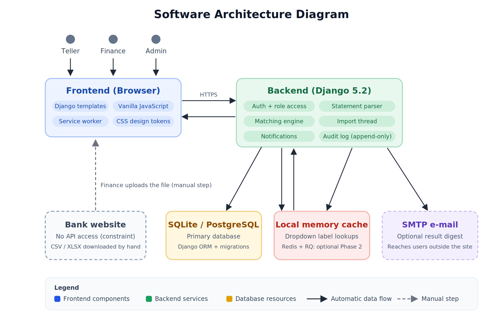
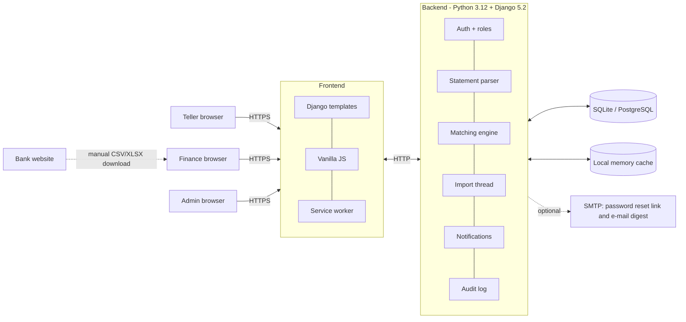

# Software Architecture

The diagram is kept as an image in the project root (`architecture-diagram.png` and `.svg`). It is not part of the website.

## Request flows

1. **Teller reports a payment.** `receipts.js` validates length rules in the browser, posts the form as JSON.
   If the server is unreachable the receipt is stored in `localStorage` with a client-generated UUID and re-sent later.
   `create_submission()` is idempotent on that UUID, takes the branch from the session and creates a *pending* match row (BR-6).
2. **Finance uploads a statement.** `start_import()` checks size, SHA-256 (BR-1), parses rows with the reader of the selected bank (RHB: header on row 4, rows 1 and 3 ignored; ALB/PBB/MBB: header row found automatically; a wrong bank choice raises `BankMismatchError`)
   and starts a background thread. The thread stores new rows, calls `run_matching()` and reports progress to the progress bar.
3. **Matching engine.** For each open receipt, the rows of **the same bank** are considered (the company branch is never a filter). The amount of a bank row is its Credit or Debit value, whichever is filled. Where the bank prints a sender name (RHB) a lenient name check (partial or re-ordered names are fine) is shown beside the match; amount + reference decide:

   | Condition | Result |
   |---|---|
   | Name (account holder vs bank name, at least 2 shared words, any order) **and** amount equal to the sen | `gfp` (score 100). The reference is NOT compared (kept for the report and the duplicate check). MBB, which prints no name, still uses amount + reference |
   | Name matches but the amount differs (closest amount) | `manual_review` ("Review", reasons in `review_reasons`, now only `amount`), only a *suggestion* |
   | Otherwise | `not_found`, retried on every new statement, however old the receipt is (BR-10) |

4. **Finance reviews.** **GFP** (blue, final link) or **Reject** (red) in the Actions column with one optional Note, send a correction request (one-way notification), or move the receipt to another branch. A bank row nobody claimed is listed under **Open Item**. The queue shows the most recently changed items first. Finance can download the weekly/monthly Excel report (Open Item and GFP). Tellers see only Pending or Verified.
5. **Notifications.** Stored in the database, shown by the bell, raised as browser notifications by polling, optionally e-mailed as a digest. Opening the notification list marks everything as read. Tellers are notified only when a receipt is Verified.

## Decisions (ADR summary)

| # | Decision | Why | Revisit when |
|---|---|---|---|
| 1 | Django templates + vanilla JS instead of a React SPA | No build tooling on Windows, fast pages on weak branch PCs, requirement NFR-PERF-2 names HTML/JS and Django ORM | The UI needs heavy client-side state |
| 2 | SQLite default, PostgreSQL supported | Zero setup for the central PC; schema stays portable | More than ~20 concurrent users or multiple servers |
| 3 | Deterministic rules + RapidFuzz, no ML | Finance must be able to explain every result; zero tolerance on amounts | Real data shows systematic misses |
| 4 | Background thread for imports | Progress bar without extra infrastructure | Imports > a few minutes: Redis + RQ |
| 5 | Suggestions are separate from final links | A Review suggestion is never final without a human (DBML v3) | - |
| 6 | Service worker + localStorage queue | Central PC is off at night (constraint) | Branches need guaranteed delivery: add Web Push + server-side queue |
| 7 | Strict CSP, no inline JS/CSS | Defence in depth for a finance tool | - |
| 8 | No Django admin site | It would offer a password-change path that BR forbids | - |
| 9 | Dropdown values live in tables (Master data), receipts store only the code | Admin adds values without a developer; renaming never breaks history | - |
| 10 | No sidebar, header navigation | Less chrome, works on small screens | - |

## Where would automation plug in?

The sheet asks: *if the bank import should be automated, where must the integration happen, an API?*
The bank gives no Open API access (NFR-PERF-1), so the integration point is **not** an API call from this system into the bank.
Everything funnels through one function, `apps.reconciliation.services.importer.start_import()`, which only needs
*the file bytes, the bank and a user*. Any future source simply calls it:

| Option | Where it lives | Needs from the bank | Risk |
|---|---|---|---|
| Keep manual download (today) | Finance browser | nothing | Human step |
| Scheduled statement e-mail or SFTP drop, if the bank offers one for corporate accounts | A small watcher script/management command that reads a mailbox or folder and calls `start_import()` | A corporate channel and approval from the bank | Low: still file based |
| Browser automation (RPA) of the bank website | Separate script on the central PC | Allowed by bank terms of use | High: breaks on page changes, may violate terms and security policy |

Recommended first step: ask the bank whether a scheduled file delivery exists. It keeps the matching code untouched.

## Security notes

* Roles enforced server-side on every view (`role_required`); tested in `AccessControlTests.test_role_matrix`.
* CSRF on all POSTs, `HttpOnly` + `SameSite=Lax` cookies, secure cookies when `DJANGO_DEBUG=False`.
* No lockout of any kind (requirement). Generic error for unknown e-mail or wrong password. "Forgot password" e-mails a unique, expiring, single-use link (Django token generator) and gives the same answer whether or not the address exists.
* Temporary passwords are shown once on a `no-store` page, never put in messages or cookies.
* Append-only audit log (updates and deletes raise errors); admins can read, not change.
* Uploaded files are parsed in memory and never stored or executed; only the hash and the parsed rows are kept.
